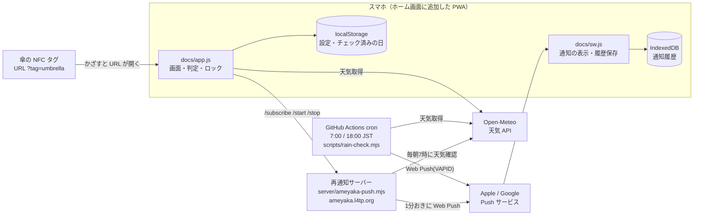

# ameyaka（アメヤカ）— 傘を、忘れない。

**雨の日だけ、傘を持つまでアプリが先に進まない。** 傘に付けた NFC タグ（「孫の手タグ」）にスマホをかざすまで通知が続き、かざすと止まって「実績解除」になる、傘の持ち忘れ防止 PWA です。

第1回 ShipLab Hackathon（テーマ「かゆいところに手が届くようなアプリ」）への出品作品です。チーム **Meeple & Koma**。

| | |
| --- | --- |
| 🎬 デモ動画（機能紹介） | <https://youtu.be/h7qicJOGZkg> |
| 📱 動くアプリ（公開URL） | <https://aizu-naranu.github.io/rain-push-pwa/> |
| 📱 雨の日を再現して開く | <https://aizu-naranu.github.io/rain-push-pwa/?demo=rain> |
| 🔁 再通知サーバー（状態確認） | <https://ameyaka.l4tp.org/status> |
| 📄 仕様書 | [docs/spec.md](docs/spec.md) |
| 🧰 技術仕様・開発手順 | [TECH.md](TECH.md) ／ [DEVELOPMENT.md](DEVELOPMENT.md) |

> 公開URLについて: アプリのコードはこのリポジトリの `docs/` が正です。このリポジトリの GitHub Pages はまだ有効にしていないため、同じ `docs/` を配信している [aizu-naranu/rain-push-pwa](https://github.com/aizu-naranu/rain-push-pwa) の Pages で公開しています（中身は同一。違いは図版フォルダの有無のみ）。

---

## 目次

1. [審査の方へ：1分で分かる要約](#1-審査の方へ1分で分かる要約)
2. [課題：どんな「かゆいところ」か](#2-課題どんなかゆいところか)
3. [解決のアイデア](#3-解決のアイデア)
4. [機能一覧と実装状況](#4-機能一覧と実装状況)
5. [試し方（審査員の方が自分で触る手順）](#5-試し方審査員の方が自分で触る手順)
6. [システム構成](#6-システム構成)
7. [実装の詳細](#7-実装の詳細)
8. [使用技術と選定理由](#8-使用技術と選定理由)
9. [動作確認の記録](#9-動作確認の記録)
10. [正直に書いておくこと（制約・モック・未実装）](#10-正直に書いておくこと制約モック未実装)
11. [審査観点との対応](#11-審査観点との対応)
12. [やらなかったこと（意図的に削ったもの）](#12-やらなかったこと意図的に削ったもの)
13. [ディレクトリ構成](#13-ディレクトリ構成)
14. [ローカルで動かす](#14-ローカルで動かす)
15. [チームと開発体制](#15-チームと開発体制)
16. [クレジット・外部サービス](#16-クレジット外部サービス)

---

## 1. 審査の方へ：1分で分かる要約

- **誰の何を解決するか**: 「晴れた朝に傘を持たずに出て、帰りに濡れる」「傘を家に忘れる」人。天気予報アプリは"雨が降る"とは教えてくれるが、**傘を持ったかどうかまでは見てくれない**。そこがかゆいところ。
- **どう解決するか**: 雨予報の日だけ、
  1. 朝に通知が来る（7:00 と、帰宅前の 18:00）
  2. 傘のタグにスマホをかざすまで、**1分おきに通知が積み上がる**（「傘、まだですか？（N回目）」）
  3. アプリを開いても、**タグをかざすまでほかの画面に進めない**
  4. 傘の柄に付けたタグにスマホをかざすと、**通知が止まり、金色の傘が揺れる「実績解除」**が出る
- **何が実際に動いているか**: 天気の取得と判定（Open-Meteo の実データ）、Web Push 通知（iPhone 実機で受信確認済み）、雨の日のロック画面と NFC タグでの解除（iPhone 実機＋市販 NFC タグで確認済み）、再通知サーバー（稼働中）、通知履歴、設定、実績解除の演出。
- **何がモックか**: 「傘の状態」画面の傘の位置・電池（センサーを持たないため固定データ。画面内に明記）。発表で見せる「孫の手の形のタグ」は手作りの試作で、スライドの孫の手タグ画像はイメージです。
- **サーバー代 0 円・有料サービス 0**。フロントはビルド不要の素の HTML/JS。

## 2. 課題：どんな「かゆいところ」か

チームのあめみやさんが、身の回りの「やらかし」を 25 件集めました。いちばん多かったのが**出がけの忘れ物**で、その中から傘の 2 件に絞りました。

| No. | やらかし | 失ったもの |
|---|---|---|
| 4 | 天気予報を見ず、朝晴れていたので手ぶらで出て、帰りに雨でずぶ濡れ | 乾いていた衣服と自分 |
| 10 | 傘を家に忘れ、持ってきた傘もコンビニに忘れた | 傘と濡れずに済む快適さ |

既存の手段で解決しない理由:

- 天気アプリの雨通知は**見て、消して、そのまま出かけられる**。通知は届いても行動（傘を持つ）につながらない。
- スマートタグ（AirTag 等）は「置き忘れ」には効くが、**家を出る前の「持ち忘れ」は見ていない**。また雨の日かどうかを知らない。

つまり欠けているのは「**雨の日に限って**」「**傘を手に取ったことを確かめる**」仕組みです。

## 3. 解決のアイデア

**「雨の日だけ、傘を持つまで進まない」**

- 晴れの日は何もしない（うるさくない）。通知が来るのは降水確率がしきい値（既定 40%）以上の日だけ。
- 雨の日は、傘を持った証拠として**傘に付けた NFC タグにスマホをかざしてもらう**。タグは傘の柄に下げておくので、かざす＝傘を手に取っている。
- かざすまで、通知は止まらず、アプリも先に進まない。かざした瞬間に止まり、ご褒美として「実績解除」と連続日数を出す（面倒な確認を、ちょっと楽しい儀式にする）。
- タグは「孫の手」の形にする、というのがコンセプトです（**かゆいところに手が届く**）。

想定する1日の流れ:

```
7:00  雨予報を判定 → 雨なら「午後から雨が降る予報です」と通知、再通知を開始
7:01  「傘、まだですか？（2回目）」
7:02  「傘、まだですか？（3回目）」 … アプリを開いても「傘のNFCタグをかざして」で止まる
7:05  玄関で傘の孫の手タグにピッ → 通知が止まる → 金色の傘「傘を持ちましたね！」
18:00 帰宅時間にも雨なら「帰宅時間に雨の予報です」（会社やコンビニへの置き忘れ対策）
```

## 4. 機能一覧と実装状況

凡例: ✅ 実装済み・動作確認済み ／ 🟡 実装済み・確認途中 ／ 🧪 モック（固定データ） ／ — 未実装

| # | 機能 | 状態 | 実装場所 |
|---|---|---|---|
| F1 | 天気の取得（地域ごと・時間ごとの降水確率） | ✅ | `docs/app.js` `loadWeather()`、`scripts/rain-check.mjs` |
| F2 | 傘が要るかの判定（しきい値は設定で変更可） | ✅ | `docs/app.js` `needsUmbrella()`、`scripts/rain-check.mjs` `compose()` |
| F3 | 朝 7:00・帰宅前 18:00 の雨通知（Web Push） | ✅（時刻は遅れることあり、§10） | `.github/workflows/rain.yml`、`scripts/rain-check.mjs`、`scripts/push-core.mjs` |
| F4 | 降り始めの時間帯で文面を変える（午前中／午後から／夕方から）、80%以上は長傘を勧める | ✅ | `scripts/rain-check.mjs` `compose()` |
| F5 | 端末ごとの地域・しきい値・通知枠 | ✅ | 購読 JSON の `settings` を `rain-check.mjs` が読む |
| F6 | **雨の日チェック（ロック画面）**: 雨の日はタグをかざすまでほかの画面に進めない | ✅ iPhone 実機で確認 | `docs/app.js` `gateActive()` `viewGate()` `render()` |
| F7 | **NFC タグで解除**: タグに書いた URL（`?tag=umbrella`）を開くと解除 | ✅ iPhone＋NTAG216 で確認 | `docs/app.js` `consumeUrlParams()` `markUmbrellaChecked()` |
| F8 | **実績解除の演出**: 揺れる金色の傘・紙吹雪・振動・「雨の日チェック N日連続」 | ✅ | `docs/app.js` `showAchievement()` `checkStreak()`、`docs/styles.css` |
| F9 | **再通知（連打）**: タグをかざすまで 1・5・10 分おきに通知が積み上がる。1日30通で打ち止め | ✅ 1分おきに届くのを実機で確認 | `server/ameyaka-push.mjs` `tick()` |
| F10 | **タグで再通知が止まる** | ✅ iPhone 実機で確認（11/19 17:10） | `docs/app.js` `stopNagging()` → サーバー `POST /stop` |
| F11 | 毎朝 7 時に雨予報なら再通知を自動開始 | ✅ 実装（自動開始の実地確認は雨の日待ち） | `server/ameyaka-push.mjs` `autoStart()` |
| F12 | 通知履歴（種別で絞り込み） | ✅ | `docs/sw.js`（受信時に保存）、`docs/store.js`（IndexedDB）、`docs/app.js` `viewHistory()` |
| F13 | 設定（通知枠3種・しきい値・地域5か所・出発/帰宅時刻・再通知の間隔・テスト通知） | ✅ | `docs/app.js` `viewSettings()` `bindSettings()` |
| F14 | デモ用の天気切り替え（雨・晴れ・大雨・実天気） | ✅ | `docs/app.js` `DEMO_PRESETS`、`?demo=` |
| F15 | ホーム画面に追加できる PWA（オフラインでも画面は開く） | ✅ | `docs/manifest.webmanifest`、`docs/sw.js` |
| F16 | 「傘の状態」画面（傘の位置・電池・接続） | 🧪 モック（画面に明記） | `docs/app.js` `viewTag()` |
| F17 | 傘立てセンサー（ESP32 等）による「傘が家に残っている」検知 | — やらない（§12） | |
| F18 | 外出先での置き忘れ検知 | — 市販スマートタグ側のアプリに任せる（§12） | |

画面（あめみやさんの Figma 設計に合わせて実装）:

| 画面 | 中身 | データ |
| --- | --- | --- |
| ホーム | 日付とあいさつ、今日の天気・降水確率・降り始めの時刻、傘の要否、今日の予定（出発・帰宅）、タグの状態 | Open-Meteo の実データ（デモ値のときは画面に表示） |
| 雨の日チェック | 「傘のNFCタグをかざして URLを開いてください」で停止 | 雨予報 × 今日まだかざしていない ときだけ出る |
| 設定 | 通知枠・しきい値・地域・時刻・再通知間隔・デモ天気・プッシュ通知の登録 | localStorage、再通知サーバー |
| 通知履歴 | 受信した通知の一覧（朝／帰宅前／再通知などで絞り込み） | IndexedDB |
| 傘の状態 | タグの接続・電池・傘の位置 | モック |

設計データ: `images/ameyaka スマホ画面設計.pdf`、`images/ホーム.png` ほか。

## 5. 試し方（審査員の方が自分で触る手順）

### A. ブラウザだけで 1 分（通知なし、PC でも可）

1. <https://aizu-naranu.github.io/rain-push-pwa/?demo=rain> を開く（天気を「雨」に固定するデモ用 URL）
2. 「傘のNFCタグをかざして URLを開いてください」の画面で止まり、メニューに進めないことを確認
3. 「タグをかざした（デモ）」を押す（タグの読み取りの代わり）→ 金色の傘の「実績解除」が出てホームに進む
4. `?tag=umbrella` を付けて開いても同じく解除される（実機ではこの URL を NFC タグに書き込んでいる）
5. もう一度ロックするには `?gate=reset` を付けて開く
6. 晴れの日の見え方: `?demo=sunny`（ロックされない）、実際の天気に戻す: `?demo=live`

### B. iPhone で通知まで（iOS 16.4 以降）

1. Safari で公開 URL を開き、共有 → **「ホーム画面に追加」**（iPhone はホーム画面のアプリからしか Web Push を受け取れません）
2. ホーム画面のアプリを開き、設定 → 「通知を有効にする」→ 許可
3. 設定 → 「テスト通知を出す」で通知が届くことを確認
4. 設定 → REMIND →「今から再通知を始める（テスト）」→ 1分おきに「傘、まだですか？（N回目）」が届く
5. 止める: 「タグをかざした（デモ）」ボタン、または `?tag=umbrella` 付きの URL を書き込んだ NFC タグにかざす

注意: 再通知の停止は試作のため、タグ経由で止めると**登録されている全端末の再通知が止まります**（§10）。

## 6. システム構成



（図が表示されない環境向けの文字版）

```
[スマホ PWA] app.js ──天気──> Open-Meteo
     │  └─ /subscribe /start /stop ──> [再通知サーバー] ──1分おき──> Push サービス ──> sw.js ──> IndexedDB
     │
[NFC タグ] ──かざす──> ?tag=umbrella を開く ──> app.js が解除 ＋ /stop

[GitHub Actions cron 7:00/18:00] ──天気──> Open-Meteo
                                  └─判定して Web Push──> Push サービス ──> sw.js
```

通知の経路は 2 本あります。

| 経路 | 役割 | 置き場 |
| --- | --- | --- |
| 定時通知 | 朝 7:00・帰宅前 18:00 に雨なら 1 通 | GitHub Actions（サーバー不要） |
| 再通知 | タグをかざすまで 1・5・10 分おきに積み上げる | 常駐の小さな Node サーバー（1分単位の送信は Actions ではできないため） |

## 7. 実装の詳細

### 7.1 天気と判定

- Open-Meteo の `hourly=precipitation_probability` と `daily=precipitation_probability_max` を取得（タイムゾーン Asia/Tokyo、当日分）。
- **傘が要る** = 当日の最大降水確率 ≥ しきい値（既定 40%、設定で変更可）。
- 降り始めの時刻 = 降水確率がしきい値を初めて超える時間。午前・午後の最大値から「午前中に雨／午後から雨／一日を通して雨」を作る。
- 帰宅前の通知は 16 時以降の最大値で判定。80% 以上は「折りたたみではなく長傘がおすすめ」と文面を変える。
- 配信側は Open-Meteo への接続失敗に備えて 5 回まで指数バックオフで再試行（実際に 2 回失敗が起きたため追加）。

### 7.2 雨の日チェック（ロック画面）

```js
// docs/app.js
function gateActive() { return settings.reinforce && needsUmbrella() && !umbrellaCheck(); }
```

- 「強化通知」が ON ／ 今日は傘が要る ／ 今日まだタグをかざしていない、の 3 つがそろうと、どのページを開いてもロック画面が描画される（`render()` がページの代わりに `viewGate()` を呼ぶ）。
- かざした記録は `localStorage` に `{ day: "2026-11-19", at, via: "tag" | "demo" }` として保存し、**日付が変わると自動で無効**になる（翌日の雨の日にまたロックされる）。
- 1.5 秒ごとに状態を見直し、別タブ（タグから開いた Safari など）で解除されたらロックを外す。

### 7.3 NFC タグでの解除

- 市販の NFC タグ（SwitchBot スマートタグ、チップは NTAG216）に `https://aizu-naranu.github.io/rain-push-pwa/?tag=umbrella` を書き込んで傘の柄に下げている。
- スマホをかざすとその URL が開き、`consumeUrlParams()` が `?tag=` を見つけて解除・記録・再通知の停止を行い、アドレスバーから引数を消す。
- **専用ハードもアプリのネイティブ化も不要**で、NFC を読めるスマホなら動く。iPhone では「NFCタグを読み取りました」の通知をタップして開く（ショートカットのオートメーションで省略可能）。

### 7.4 再通知サーバー（`server/ameyaka-push.mjs`、約200行、依存は `web-push` のみ）

| API | 中身 |
| --- | --- |
| `POST /subscribe` | `{subscription, settings:{intervalMin, threshold, lat, lon}}` 端末を登録・更新 |
| `POST /start` | `{endpoint}` 今から再通知を始める（設定画面のテストボタン）。外部からの「全端末を鳴らす」は拒否 |
| `POST /stop` | `{endpoint?}` 今日の再通知を止める（タグをかざしたとき）。endpoint が無ければ全端末 |
| `GET /status` | 各端末の状態（再通知中か、今日何通送ったか）。endpoint は先頭だけ表示 |

- 10 秒ごとのループで、再通知中の端末に「設定間隔が過ぎていれば 1 通」送る。
- 1 通ずつ別の `tag` を付けるので、iPhone の通知センターに**上書きされずに積み上がる**（「傘、まだですか？（2回目）」「（3回目）」…）。
- 止め忘れても鳴り続けないよう **1日30通で打ち止め**。日付が変わると止まる。
- 毎朝 7 時（JST）に各端末の地域の降水確率を確認し、しきい値以上なら自動で開始。
- 失効した購読（404/410）は自動で削除。状態は `~/.ameyaka/state.json` に原子的に書き込み（tmp → rename）。
- VAPID 秘密鍵は環境変数か `~/.ameyaka/env`（権限 600）で渡し、リポジトリには入れていない。
- 127.0.0.1 で待ち受け、Cloudflare Tunnel 経由で `https://ameyaka.l4tp.org/` として公開。`systemd --user` で常駐。

### 7.5 定時通知（GitHub Actions）

- `.github/workflows/rain.yml` が `0 22 * * *`（7:00 JST）と `0 9 * * *`（18:00 JST）に起動し、`scripts/rain-check.mjs` を実行。
- 購読ごとに `settings`（地域・しきい値・朝/夕の ON/OFF）を読んで**人ごとに判定**して送信。
- 手動実行（Run workflow）で任意の本文を送ることもできる。失効した購読は自動で削除してコミット。
- 購読情報はリポジトリの `subscriptions.json` か、Actions Secret `SUBSCRIPTIONS_JSON`（公開したくない場合、こちらが優先）。

### 7.6 Service Worker・通知履歴・PWA

- `sw.js` が push を受けて `showNotification` し、同時に IndexedDB に履歴を保存。開いている画面に `postMessage` して履歴を即時更新。
- 通知をタップするとアプリが開く。
- 画面のファイルは毎回サーバーに更新を確かめ（`cache: "no-cache"`）、オフライン時だけキャッシュを使う。ホーム画面アプリで古い版が残る問題への対処。
- 天気 API はキャッシュしない。

## 8. 使用技術と選定理由

| 領域 | 採用 | 理由 |
| --- | --- | --- |
| フロント | 素の HTML / CSS / JavaScript（ビルドなし） | GitHub Pages にそのまま置ける。環境構築に時間を使わない |
| アプリ形態 | PWA（Web App Manifest ＋ Service Worker） | アプリストア審査なしで iPhone にも配れ、iOS 16.4 以降は Web Push が使える |
| 通知 | Web Push（VAPID）＋ `web-push` 3.6.7 | Apple / Google の Push サービスに直接送れる。外部の通知サービス不要 |
| 天気 | [Open-Meteo](https://open-meteo.com/) | API キー不要、時間単位の降水確率が取れる |
| 傘の検知 | NFC タグ（NTAG216）に URL を書くだけ | 電池不要。スマホ標準の NFC 読み取りで URL が開くので専用アプリが要らない |
| 定時実行 | GitHub Actions の cron | サーバーを持たずに定時実行できる |
| 再通知 | Node.js の小さな常駐サーバー（標準 `http` のみ） | 1 分おきの送信と「止めた」状態の一元管理には常駐が要る |
| 公開口 | Cloudflare Tunnel | 自宅サーバーを HTTPS で安全に公開（ポート開放なし） |
| 保存 | localStorage（設定・チェック）／ IndexedDB（履歴。Service Worker から書けるため） | ログイン・DB サーバーなし |

有料サービスは使っていません。

## 9. 動作確認の記録

| 日付 | 確認したこと | 結果 |
| --- | --- | --- |
| 11/13 | iPhone 実機に Web Push が届く（手元から直送、Actions 経由の両方） | ✅ |
| 11/15 | 降水確率 100% →「今日は傘が必要です」自動送信 | ✅ |
| 11/15 夕 | 100% →「帰宅時間に雨の予報です」 | ✅ |
| 11/16 | 47%（しきい値 50% 未満）→ **送らない** | ✅ 意図どおり |
| 11/17 | 100% →「帰宅時間に雨の予報です」 | ✅ |
| 11/17 | iPhone 実機で雨の日ロック → NFC タグにかざして解除 | ✅ |
| 11/18 | 再通知が 1 分おきに間引かれず届く（iPhone 実機） | ✅ |
| 11/19 17:06〜17:14 | 再通知を開始 → 1分おきに5通送信 → 17:10 にタグをかざす → サーバーが停止を受信、以後は通知が来ない（再開・再停止もやり直して同じ結果） | ✅ |

GitHub Actions の実行履歴: <https://github.com/yousan/Meeple-and-Koma/actions>

## 10. 正直に書いておくこと（制約・モック・未実装）

- **「傘の状態」画面はモックです。** 傘の位置・電池・接続は固定データで、画面内にもその旨を表示しています。傘を持ったかどうかの判定は、実際には **NFC タグをかざしたか** で行っています。
- **孫の手タグはコンセプトです。** 試作は市販の NFC タグ（シール型で大きめ）＋竹で手作りした小さな孫の手。スライドの孫の手タグ画像はイメージ（生成画像）です。製品にするなら 2×12mm 程度のガラスカプセル型 NFC を孫の手に埋め込む想定です。
- **タグで止めると全端末の再通知が止まります。** iPhone ではタグの URL がホーム画面アプリではなく Safari で開くため、どの端末の購読か分からず「全端末停止」にしています。複数人で使うなら、タグごとに ID を書いて端末と結びつける必要があります。
- **iPhone の通知バナーはスワイプで消せます。** 「消せない通知」ではなく、消せなくしているのは**アプリの中の画面**（傘を持つまで先に進まない）と、**止めるまで次の通知が来ること**です。
- **定時通知の時刻は遅れます。** GitHub Actions の cron は混雑時に遅れる仕様で、実測で数時間遅れたことがあります。正確に 7 時に鳴らすのは再通知サーバー側の自動開始で補っています。
- **購読の登録が一部手作業。** 定時通知（Actions）の対象にするには、設定画面に出る購読 JSON を `subscriptions.json` か Secret に追加する必要があります（静的ホスティングの制約）。再通知サーバーへの登録は自動です。
- **再通知サーバーは試作機として個人環境で動かしています。** 停止していると再通知だけが届かなくなります（ロック画面・解除・定時通知は影響を受けません）。
- ログイン機能はありません。設定とチェックの記録は端末の中だけに保存されます。

## 11. 審査観点との対応

| 観点 | このプロダクトでの答え |
| --- | --- |
| 的確性（テーマに合っているか） | 実際に集めた 25 件の「やらかし」から最多の「出がけの忘れ物」、その中の傘に絞った。天気アプリでもスマートタグでも埋まらない「雨の日に、傘を手に取ったか」という隙間を狙った。孫の手タグで「かゆいところに手が届く」をそのまま形にした |
| 完成度（動くか） | 天気取得・判定・定時通知・再通知・ロック・NFC 解除・履歴・設定まで一通り実機で動作（§9）。モックは「傘の状態」画面だけで、画面上にも明記 |
| 訴求力（伝わるか） | 「雨の日だけ、傘を持つまで進まない」の一文で説明できる。通知が積み上がる → ピッで止まる → 金色の傘、という流れがデモで一目で分かる |
| 操作感（使いやすいか） | 晴れの日は何も出ない。雨の日の操作は「タグにかざす」1 回だけ。解除時に演出と連続日数で小さなご褒美。Figma 設計に沿った 4 画面、スマホ・PC 両対応、ホーム画面に追加して使える |

## 12. やらなかったこと（意図的に削ったもの）

ハッカソンの期間で「デモで確実に動くもの」に集中するため、次の案は採用しませんでした。

| 案 | やらなかった理由 |
| --- | --- |
| 傘立てセンサー（ESP32・重量/距離センサー） | ハードの製作・配線・通信で期間内の完成が危うい。NFC タグなら電池も配線も不要で同じ「傘を手に取った」を確かめられる |
| サーボ等で物理的に知らせる仕掛け | 同上 |
| ネイティブアプリ化（Flutter 等） | ストア配布が間に合わない。PWA で通知とロックが実現できた |
| ログイン・アカウント | デモに不要。端末内の保存で足りる |
| LINE / Discord への通知 | Web Push が iPhone 実機で安定して届いたため不要になった |
| 外出先での置き忘れ検知 | 市販スマートタグの専用アプリが得意な領域なので任せる |

## 13. ディレクトリ構成

```
.
├── docs/                    アプリ本体（GitHub Pages の公開元、ビルド不要）
│   ├── index.html
│   ├── app.js               画面・天気取得・判定・ロック・解除・実績解除・設定（約900行）
│   ├── sw.js                Service Worker（push 受信、通知表示、履歴保存、キャッシュ）
│   ├── store.js             IndexedDB の通知履歴
│   ├── styles.css
│   ├── config.js            VAPID 公開鍵・再通知サーバーの URL
│   ├── manifest.webmanifest
│   ├── icons/
│   └── spec.md              仕様書
├── server/
│   └── ameyaka-push.mjs     再通知サーバー
├── scripts/
│   ├── rain-check.mjs       定時の天気判定と送信（Actions から実行）
│   ├── push-core.mjs        送信の共通処理（失効購読の削除など）
│   ├── send.mjs             手動送信
│   ├── gen-keys.mjs         VAPID 鍵の生成
│   ├── make-icons.mjs       アイコン生成
│   ├── serve.mjs            ローカル確認用サーバー
│   └── env.mjs
├── .github/workflows/rain.yml   定時通知（7:00 / 18:00 JST）
├── subscriptions.json       定時通知の購読先
├── images/                  Figma の画面設計、発表資料 v2
├── TECH.md                  技術仕様
└── DEVELOPMENT.md           開発・運用手順
```

## 14. ローカルで動かす

```sh
npm install
npm run serve                 # http://localhost:8080 でアプリ（docs/）を配信
npm run keys                  # VAPID 鍵を生成（公開鍵を docs/config.js に貼る）
npm run rain -- --dry-run     # 朝の判定を送らずに確認
npm run rain -- --slot=evening --dry-run
npm run rain -- --mock-prob=70 --dry-run   # 降水確率を固定して判定
npm run push -- "今日は傘が必要です" "降水確率70%。"   # 手動送信

# 再通知サーバー（VAPID_PUBLIC_KEY / VAPID_PRIVATE_KEY が必要）
node server/ameyaka-push.mjs  # 127.0.0.1:8911
curl -s localhost:8911/status
```

鍵の発行、Actions の Secrets/Variables、購読の登録、iOS の注意点は [DEVELOPMENT.md](DEVELOPMENT.md) を参照してください。

## 15. チームと開発体制

チーム **Meeple & Koma**（ミープル＝あめみやさん、将棋の駒＝yousan）

| メンバー | 担当 |
| --- | --- |
| あめみやさん | やらかし集 25 件の収集、課題の発見、アプリ名「ameyaka」、Figma の画面設計、仕様書（`docs/spec.md`）、発表資料 v2、機能紹介デモ動画 |
| yousan | 方向付け、iPhone 実機テスト、NFC タグの検証と孫の手タグの試作、発表、提出 |
| じゅう（AI アシスタント） | 実装（PWA・通知・再通知サーバー）、発表スライドと動画の制作補助 |

AI の使い方: yousan が Discord のスレッドで指示し、OpenClaw 上の AI アシスタント「じゅう」（Anthropic Claude）がコードを書き、検証し、このリポジトリに push する形で開発しました。仕様と画面設計は人が決め、AI は実装と検証を担当しています。

## 16. クレジット・外部サービス

- 天気データ: [Open-Meteo.com](https://open-meteo.com/)（CC BY 4.0）
- Web Push 送信: [web-push](https://github.com/web-push-libs/web-push)（MPL-2.0）
- NFC タグ: SwitchBot スマートタグ（NTAG216）を URL 書き込みに使用
- 発表資料・動画の一部の絵は Google Gemini で生成（SynthID の透かし入り）。このリポジトリのアプリには含みません
